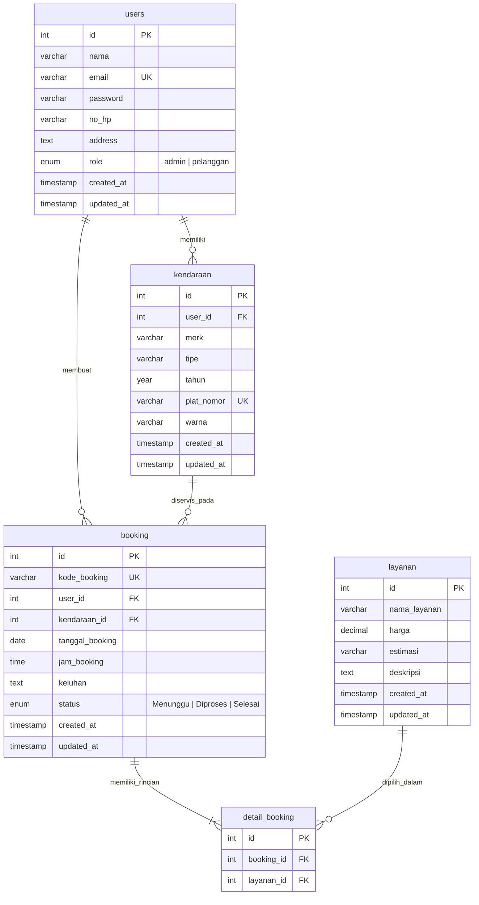

# ERD & Dokumentasi API — Aplikasi Booking Servis Bengkel

## 1. Entity Relationship Diagram (ERD)

Database `db_booking_bengkel` terdiri dari **5 tabel utama yang saling berelasi**: `users`, `kendaraan`, `layanan`, `booking`, dan `detail_booking`.

## 2. Penjelasan Relasi Database

| Relasi | Kardinalitas | Aturan Referensial | Keterangan |
|---|---|---|---|
| `users` → `kendaraan` | 1 : N | `ON DELETE RESTRICT`, `ON UPDATE CASCADE` | Satu pelanggan dapat memiliki banyak kendaraan. |
| `users` → `booking` | 1 : N | `ON DELETE RESTRICT`, `ON UPDATE CASCADE` | Satu pelanggan dapat membuat banyak booking servis. |
| `kendaraan` → `booking` | 1 : N | `ON DELETE RESTRICT`, `ON UPDATE CASCADE` | Satu kendaraan dapat memiliki banyak riwayat booking. |
| `booking` → `detail_booking` | 1 : N | `ON DELETE CASCADE`, `ON UPDATE CASCADE` | Satu booking dapat memilih satu atau lebih layanan servis. |
| `layanan` → `detail_booking` | 1 : N | `ON DELETE RESTRICT`, `ON UPDATE CASCADE` | Layanan yang sudah dipakai pada booking terlindungi dari penghapusan. |

## 3. Daftar Endpoint REST API (`http://localhost:3000`)

### Autentikasi
| Method | Endpoint | Akses | Keterangan |
|---|---|---|---|
| `POST` | `/auth/register` | Publik | Registrasi akun pelanggan baru |
| `POST` | `/auth/login` | Publik | Login admin / pelanggan (mengembalikan JWT Token) |
| `GET` | `/profile` | Login | Melihat data token user aktif |

### Dashboard (Admin)
| Method | Endpoint | Akses | Keterangan |
|---|---|---|---|
| `GET` | `/dashboard` | Admin | Statistik pelanggan, kendaraan, layanan, booking per status, & total pendapatan |

### Pelanggan (Admin)
| Method | Endpoint | Akses | Keterangan |
|---|---|---|---|
| `GET` | `/pelanggan` | Admin | Daftar pelanggan (mendukung `?search=`) |
| `GET` | `/pelanggan/:id` | Admin | Detail 1 pelanggan |
| `POST` | `/pelanggan` | Admin | Tambah pelanggan |
| `PUT` | `/pelanggan/:id` | Admin | Edit data pelanggan |
| `DELETE` | `/pelanggan/:id` | Admin | Hapus pelanggan |

### Kendaraan
| Method | Endpoint | Akses | Keterangan |
|---|---|---|---|
| `GET` | `/kendaraan` | Pelanggan | Daftar kendaraan milik pelanggan login |
| `POST` | `/kendaraan` | Pelanggan | Tambah kendaraan milik pelanggan login |
| `PUT` | `/kendaraan/:id` | Pelanggan | Edit kendaraan milik pelanggan login |
| `DELETE` | `/kendaraan/:id` | Pelanggan | Hapus kendaraan milik pelanggan login |
| `GET` | `/kendaraan/admin` | Admin | Semua kendaraan pelanggan (mendukung `?user_id=` & `?search=`) |
| `POST` | `/kendaraan/admin` | Admin | Tambah kendaraan atas nama pelanggan |
| `PUT` | `/kendaraan/admin/:id` | Admin | Edit kendaraan pelanggan |
| `DELETE` | `/kendaraan/admin/:id` | Admin | Hapus kendaraan pelanggan |

### Layanan
| Method | Endpoint | Akses | Keterangan |
|---|---|---|---|
| `GET` | `/layanan` | Login | Daftar semua layanan bengkel (mendukung `?search=`) |
| `GET` | `/layanan/:id` | Login | Detail layanan |
| `POST` | `/layanan` | Admin | Tambah layanan |
| `PUT` | `/layanan/:id` | Admin | Edit layanan |
| `DELETE` | `/layanan/:id` | Admin | Hapus layanan |

### Booking Servis
| Method | Endpoint | Akses | Keterangan |
|---|---|---|---|
| `POST` | `/booking` | Pelanggan | Buat booking baru (`layanan_ids: [1, 2]` atau `layanan_id: 1`) |
| `GET` | `/booking` | Pelanggan | Riwayat & status booking milik pelanggan login |
| `GET` | `/booking/:id` | Pemilik / Admin | Detail booking beserta rincian item layanan & total harga |
| `GET` | `/booking/admin` | Admin | Semua booking (mendukung `?search=`, `?status=`, `?tanggal=`) |
| `POST` | `/booking/admin` | Admin | Admin membuat booking baru untuk pelanggan |
| `PUT` | `/booking/admin/:id` | Admin | Admin mengedit booking & rincian layanan |
| `DELETE` | `/booking/admin/:id` | Admin | Admin menghapus booking |
| `PUT` | `/booking/status/:id` | Admin | Ubah status booking (`Menunggu`, `Diproses`, `Selesai`) |
